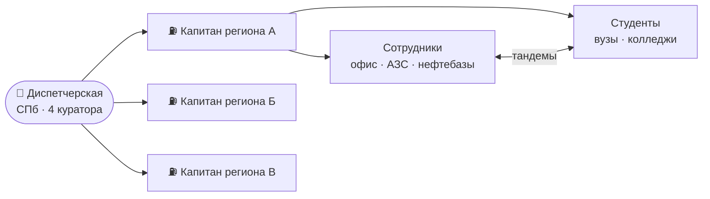

<div align="center">

# 🔗 «Своя сеть»
### Программа амбассадоров «Газпром нефти» — решение кейса

**Intelligence Cup 2026 · Кейс «HR и бренд работодателя»**


</div>

---

## 💡 Идея в одном абзаце

У компании есть сеть АЗС и нефтебаз по всей стране. **«Своя сеть»** — это такая же сеть,
только из людей: в каждом регионе есть своя «станция» амбассадоров, в Санкт-Петербурге —
«диспетчерская», а топливо, на котором всё работает, — живые истории сотрудников и студентов.

> **Главный принцип:** у разных аудиторий разные ресурсы. Офисный сотрудник напишет статью,
> оператор АЗС — снимет 30 секунд между сменами, студент колледжа ищет практику, студент вуза
> умеет в контент. Программа подстраивает задачи под ресурс, а не раздаёт всем одно и то же.



## 🗺️ Навигация

| Блок | Вопрос кейса | Документ |
|---|---|---|
| 🎯 Концепция | 1 · Образ идеальной программы | [docs/00-concept.md](docs/00-concept.md) |
| 👷 Внутренние | 1–4 · Роли, путь, каналы, мотивация | [docs/internal/](docs/internal/) |
| 🎓 Внешние | 1–4 · Роли, путь, каналы, мотивация | [docs/external/](docs/external/) |
| 🤝 Взаимодействие | 5 · Связка сотрудников и студентов | [docs/common/interaction.md](docs/common/interaction.md) |
| 📊 Метрики | 6 · Оценка эффективности | [docs/common/metrics.md](docs/common/metrics.md) |
| 🌍 Регионы | Доп. задание · Масштабирование из СПб | [docs/common/regions.md](docs/common/regions.md) |
| 🖥️ Презентация | Структура 12 слайдов | [presentation/slides-outline.md](presentation/slides-outline.md) |
| 🔍 Конкуренты | Анализ аналогов | [research/competitors.md](research/competitors.md) |

## ✅ Как решение отвечает на ограничения кейса

| Ограничение | Ответ |
|---|---|
| Амбассадоры делают контент о преимуществах компании | Рубрики привязаны к 5 преимуществам → [каналы](docs/internal/03-channels.md) |
| Оплата не предусмотрена | 10+ нематериальных мотиваторов → [внутр.](docs/internal/04-mechanics-motivation.md), [внешн.](docs/external/04-mechanics-motivation.md) |
| Цикл сентябрь → май | Пятиуровневый путь, привязанный к месяцам → [путь](docs/internal/02-journey.md) |
| Офис ≠ АЗС и нефтебазы | Отдельный облегчённый трек «Голос объекта» |
| 4 куратора на ~100 человек | Капитаны регионов + бот + банк заданий → [регионы](docs/common/regions.md) |

## 🗂️ Структура репозитория

```
svoya-set/
├── README.md                    ← вы здесь
├── docs/
│   ├── 00-concept.md            концепция и образ программы
│   ├── internal/                сотрудники: роли, путь, каналы, мотивация
│   ├── external/                студенты: роли, путь, каналы, мотивация
│   └── common/                  взаимодействие, метрики, регионы
├── presentation/
│   └── slides-outline.md        раскладка по 12 слайдам
├── research/
│   └── competitors.md           шаблон анализа конкурентов
├── ROADMAP.md                   план работы команды до финала
└── CONTRIBUTING.md              как команда работает с репозиторием
```

## 👥 Команда

| Участник | Зона ответственности |
|---|---|
| _Имя_ | Внутренние амбассадоры |
| _Имя_ | Внешние амбассадоры |
| _Имя_ | Метрики и регионы |
| _Имя_ | Дизайн презентации |
