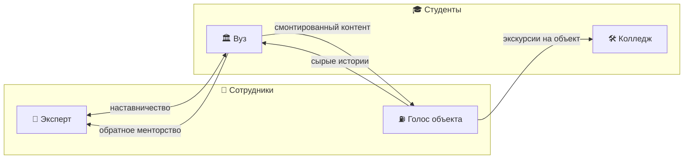

# 🤝 Взаимодействие внутренних и внешних амбассадоров

> Вопрос кейса №5.

## Пять форматов

| # | Формат | Что происходит | Польза для сотрудника | Польза для студента |
|---|---|---|---|---|
| 1 | 👥 **Тандемы** | студента закрепляем за сотрудником-наставником его региона | развитие наставнических навыков | взгляд изнутри, ментор |
| 2 | 🎬 **Контент-лаборатория** | студенты монтируют истории сотрудников АЗС и нефтебаз | контент без затрат времени | реальное портфолио |
| 3 | 🔁 **Обратное менторство** | студенты учат сотрудников соцсетям и видео | новые навыки | опыт преподавания |
| 4 | 🏭 **Совместные мероприятия** | сотрудники проводят экскурсии, студенты собирают группы; эксперты — жюри мини-кейсов | признание экспертизы | доступ на объекты |
| 5 | 🔄 **От студента до сотрудника** | бывший студент-амбассадор становится сотрудником-амбассадором | — | понятный карьерный путь |

## Почему это работает
Контент-лаборатория закрывает главную слабость внутренней программы: у сотрудников объектов
есть истории, но нет времени на продакшен. Студенты получают то, чего им не хватает, — доступ
к реальной работе. Обе стороны закрывают дефицит друг друга.
