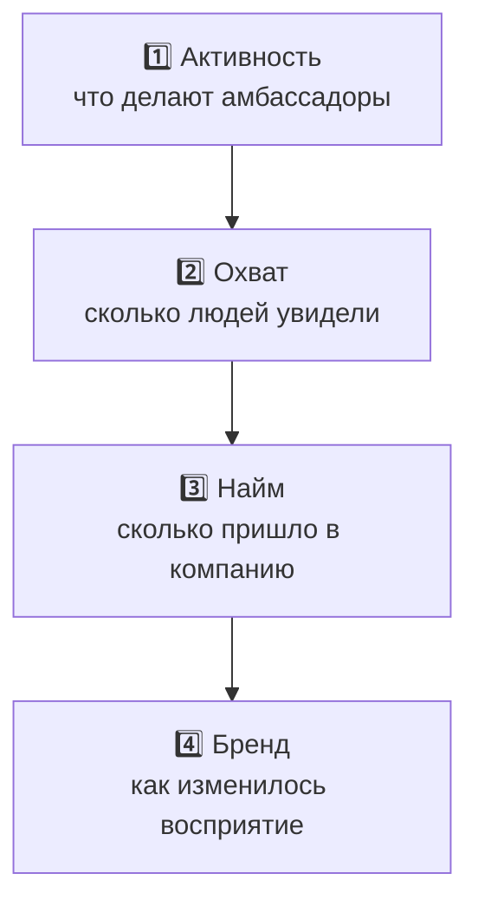

# 📊 Метрики эффективности

> Вопрос кейса №6. Метрики выстроены по воронке: от активности к бизнес-эффекту.

| Уровень | Метрика | Как считать | Частота |
|---|---|---|---|
| 1 · Активность | доля активных амбассадоров | выполнил ≥1 задание за месяц / всего | ежемесячно |
| 1 · Активность | удержание до мая | дошли до финала / стартовали | раз в цикл |
| 1 · Активность | число публикаций и мероприятий | данные бота | ежемесячно |
| 2 · Охват | просмотры и ER публикаций | статистика площадок | ежемесячно |
| 2 · Охват | участники мероприятий | регистрации | по событию |
| 3 · Найм | заявки на практику из «амбассадорских» учебных заведений | UTM-ссылки, анкеты | ежеквартально |
| 3 · Найм | конверсия практика → найм | данные HR | раз в цикл |
| 3 · Найм | наймы по реферальной программе | реферальная система | ежеквартально |
| 4 · Бренд | узнаваемость как работодателя в целевых вузах | опрос в начале и в конце цикла | 2 раза за цикл |
| 4 · Бренд | eNPS амбассадоров против остальных сотрудников | пульс-опрос | 2 раза за цикл |

## Атрибуция
У каждого амбассадора — **персональная UTM-ссылка или промокод** на анкету практики или вакансию.
Так вклад виден не только в лайках, но и в заявках.

## Целевые ориентиры для первого цикла
> Заполнить после согласования с организаторами; не выдумывать цифры без базы.

| Метрика | База (сейчас) | Цель |
|---|---|---|
| Доля активных | ? | ? |
| Удержание до мая | ? | ? |
| Заявки на практику | ? | ? |
