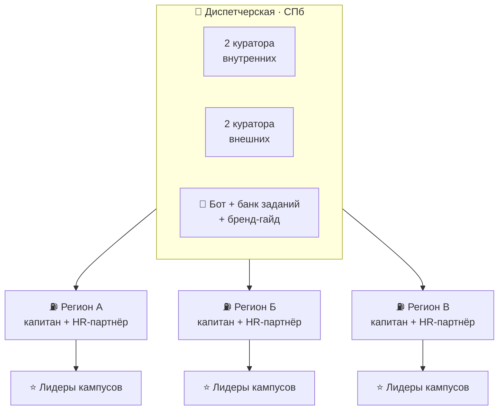
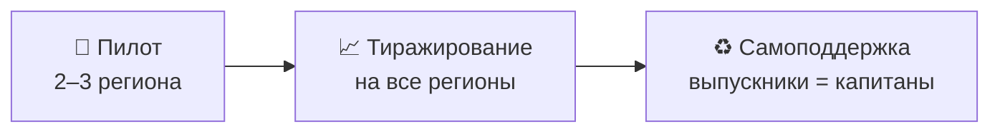

# 🌍 Развитие программы по регионам

> Дополнительное задание: кураторы и управляющая компания — в Санкт-Петербурге.

## Модель «хаб и споки»

## Кто за что отвечает

| Уровень | Роль | Что делает |
|---|---|---|
| СПб | Кураторы | стратегия, календарь, банк заданий, шаблоны, обучение капитанов |
| СПб | Бот | рутина: задачи, баллы, напоминания, рейтинг |
| Регион | Капитан | запуск задач на месте, поддержка новичков |
| Регион | HR-партнёр | связь с местными вузами и колледжами |
| Кампус | Лидер кампуса | координация студентов учебного заведения |

## Нагрузка кураторов
~100 амбассадоров / 4 куратора ≈ **25 человек на куратора**, но работа идёт через капитанов
и лидеров кампусов. Куратор ведёт 5–8 «узлов», а не 25 отдельных людей.

## Формат
- **Онлайн по умолчанию:** бот, ежемесячные созвоны, общий канал.
- **Офлайн дважды за цикл:** кик-офф в сентябре (регионально) и финал в мае (СПб для лучших).
- **Выездные дни кураторов** в регионы с самыми сильными командами.

## Масштабирование

Критерии выбора пилотных регионов: сильные профильные вузы и колледжи, активный HR-партнёр,
плотная сеть объектов.
