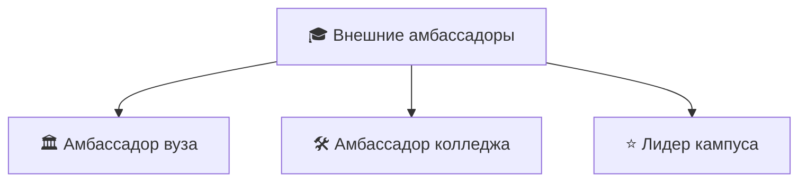

# 🎓 Внешние амбассадоры: роли

> Вопрос кейса №1 для студентов вузов и колледжей.

## 🛠️ Амбассадор колледжа
- Рассказывает сверстникам о практике и первой работе на АЗС и нефтебазах.
- Помогает собирать группы на экскурсии на объекты.
- Делает простой контент: «как я попал на практику», «что спрашивают на собеседовании».
- **Зачем компании:** колледжи — прямой источник кадров для объектов.

## 🏛️ Амбассадор вуза
- Ведёт контент о компании в студенческих сообществах.
- Участвует в ярмарках вакансий и карьерных встречах.
- Работает в контент-лаборатории: снимает и монтирует истории сотрудников.
- Организует мероприятия: мини-кейс-чемпионаты, дни компании.
- **Зачем компании:** пайплайн на стажировки в офисы и на инженерные позиции.

## ⭐ Лидер кампуса
- Старший амбассадор, координирует команду в своём учебном заведении.
- Связующее звено с капитаном региона и кураторами.
- Обычно — студент второго цикла программы.
