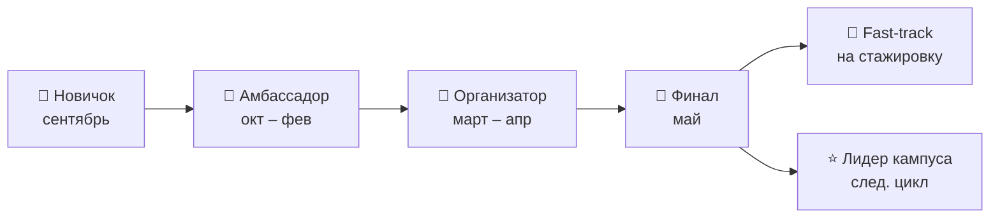

# 🛤️ Путь внешнего амбассадора

> Вопрос кейса №2 — от старта до запуска собственной инициативы.

| Уровень | Когда | Что делает | Что получает |
|---|---|---|---|
| 🌱 **Новичок** | сентябрь | отбор, вводная встреча, первая экскурсия на объект | мерч, наставник из компании |
| 📣 **Амбассадор** | октябрь – февраль | контент, ярмарки вакансий, информация о практиках | баллы, навыки SMM и коммуникаций |
| 🎪 **Организатор** | март – апрель | своё мероприятие в вузе или колледже | опыт проектной работы, кейс в портфолио |
| 🏁 **Финал** | май | защита проекта на Demo Day | fast-track на стажировку, рекомендательное письмо |

## Различия для вузов и колледжей

| | Колледж | Вуз |
|---|---|---|
| Цель | практика → работа на объекте | стажировка в офисе или на инженерной позиции |
| Типичный проект | день открытых дверей на нефтебазе | мини-кейс-чемпионат |
| Наставник | сотрудник АЗС или нефтебазы | офисный эксперт |
