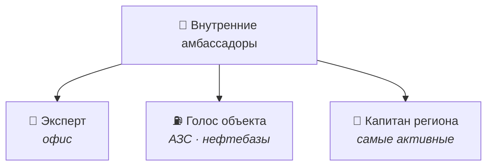

# 👷 Внутренние амбассадоры: роли

> Вопрос кейса №1 для сотрудников (офисы, АЗС, нефтебазы).

## 💼 Эксперт — офисные сотрудники
- Выступает на внешних и внутренних мероприятиях, в том числе в вузах региона.
- Пишет статьи и посты для карьерных площадок и личных страниц.
- Становится наставником студента-амбассадора.
- **Нагрузка:** 2–4 часа в месяц.

## ⛽ Голос объекта — сотрудники АЗС и нефтебаз
- Делится короткими историями: смена, карьерный путь, безопасность, команда.
- Минимальная единица участия — **голосовое сообщение или 30-секундное видео с телефона**.
- Монтаж и упаковку берут на себя студенты из контент-лаборатории.
- Проводит экскурсии для студентов на свой объект.
- **Нагрузка:** 30–60 минут в месяц, согласовано с руководителем объекта.

## 🧭 Капитан региона
- 1–2 человека на регион, выбираются из самых активных амбассадоров.
- Запускает задачи из банка заданий на месте, отвечает на вопросы новичков.
- Связывает внутренних и внешних амбассадоров региона.
- Раз в месяц созванивается с кураторами.
- **Нагрузка:** 4–6 часов в месяц; статус учитывается в оценке и кадровом резерве.
