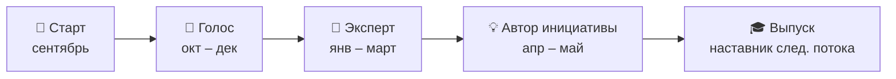

# 🛤️ Путь внутреннего амбассадора

> Вопрос кейса №2 — от старта до запуска собственной инициативы.

| Уровень | Когда | Что делает | Что получает |
|---|---|---|---|
| 🚀 **Старт** | сентябрь | отбор, онбординг, знакомство с капитаном | стартовый набор: мерч, гайд, шаблоны |
| 📣 **Голос** | октябрь – декабрь | задания из банка: первый пост, история, участие в съёмке | первые баллы, место в рейтинге |
| 🎤 **Эксперт** | январь – март | выступления, экскурсии, наставничество студента | обучение: медиашкола, ораторское мастерство |
| 💡 **Автор инициативы** | апрель – май | свой проект, защита на Demo Day | премия, встреча с топ-менеджментом |
| 🎓 **Выпуск** | июнь → сентябрь | наставник нового потока | статус в кадровом резерве |

## Облегчённый трек для АЗС и нефтебаз

Те же уровни, но с адаптированными задачами:

| Уровень | Задача для «Голоса объекта» |
|---|---|
| Голос | 3 коротких видео или голосовых за квартал |
| Эксперт | 1 экскурсия для студентов на свой объект |
| Автор инициативы | Идея улучшения жизни объекта или проекта для студентов колледжа |

## Пример инициатив на Demo Day
- «Неделя открытых дверей» на нефтебазе для местного колледжа.
- Серия видео «Профессии АЗС за минуту».
- Внутренний клуб наставников для новичков-операторов.
