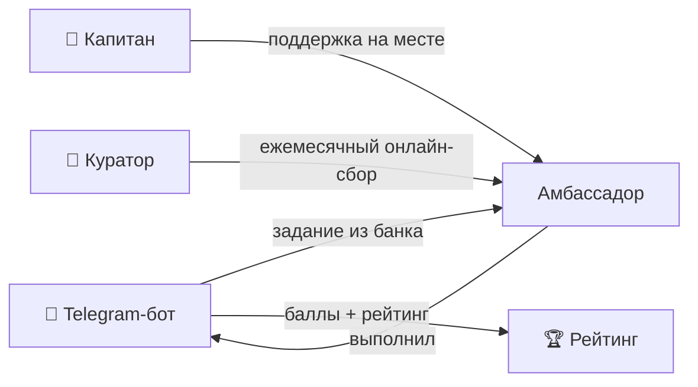

# ⚙️ Механика и мотивация внутренних амбассадоров

> Вопрос кейса №4 — привлечение, взаимодействие, мотивация. Оплата не предусмотрена.

## 🧲 Привлечение

| Канал | Как работает |
|---|---|
| Открытый призыв | анонс в корпоративных каналах в августе, короткая анкета |
| Номинация руководителя | руководитель предлагает сотрудника, который уже «говорит за компанию» |
| «Заметили в чате» | кураторы приглашают тех, кто сам активен в корпоративных каналах |
| Рекомендация амбассадора | действующий амбассадор приводит коллегу |

## 🔄 Взаимодействие

- **Банк заданий:** 30–40 типовых задач разной сложности с баллами.
- **Бот:** выдача задач, приём результатов, баллы, напоминания, рейтинг.
- **Ритм:** ежемесячная онлайн-встреча, ежеквартальный разбор лучших кейсов.
- **Руководители объектов** заранее согласуют участие, чтобы оно не мешало сменам.

## 🎁 Мотивация без денег

| Тип | Мотиватор |
|---|---|
| 📈 Карьера | учёт активности в оценке и ИПР, путь в кадровый резерв |
| 🧠 Развитие | медиашкола, ораторское мастерство, курсы корпоративного университета |
| 👀 Видимость | встреча с топ-менеджментом, публикации во внешних медиа |
| 🎟️ Опыт | поездка на итоговое мероприятие в СПб, отраслевые конференции |
| 🎁 Мерч | баллы обмениваются на лимитированный мерч амбассадоров |
| 🏆 Признание | премия «Амбассадор года», статус в корпоративных каналах |

## Баллы → награды

| Баллы | Награда |
|---|---|
| 100 | базовый мерч |
| 300 | курс корпоративного университета |
| 600 | участие в отраслевой конференции |
| ТОП-10 года | поездка на финал в СПб + встреча с топ-менеджментом |

> Пороги — ориентировочные, калибруются после первого квартала.
